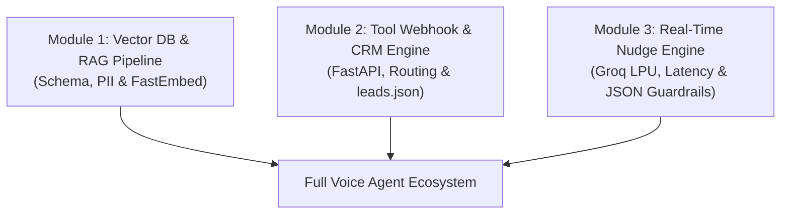

# AI Engineer Technical Assessment: Voice AI, RAG & Real-Time Systems

This document serves as an evaluation framework designed by an AI Engineering Hiring Manager/Recruiter. It contains the exact live-coding and architectural modules an interviewer would ask a candidate to build, inspect, or test from this codebase, along with the expected engineering approach and reference implementation code.

---

## 🎯 Hiring Manager Overview

### Role
**Senior AI / Machine Learning Engineer (Voice AI & Real-Time RAG)**

### What We Are Evaluating
1. **Production Vector Data Engineering**: Schema modeling, PII redaction, ONNX vs PyTorch resource constraints, and serverless vector indexing.
2. **Real-Time API & Tool Calling**: Webhook architectures, sub-200ms response times, and multi-schema payload parsing (Vapi tool calls).
3. **Conversational Tooling & Escalation**: Secure lead capturing, graceful defaults when callers refuse info, and audit-ready CRM persistence.
4. **Sub-Second LLM Inference**: Sliding-window context design, JSON mode enforcement, and ultra-low-latency signal extraction.

---

## 📋 The 3 Live Coding Modules



---

## 🧩 Module 1: Vector DB Schema & Lightweight Embedder

### 1. Interviewer Prompt
> *"We are building a production RAG system for a health insurance voice assistant deployed on a 512MB RAM container. I want you to code two things:*
> *1. A validated Pydantic schema for our knowledge base records (`KBRecord`) that tracks metadata, category taxonomy, and PII status.*
> *2. A memory-efficient embedder that generates 384-dimensional dense vectors using ONNX/FastEmbed (not raw PyTorch) to prevent OOM kills, sanitizes metadata for Pinecone compatibility, and provides a local fallback cache."*

### 2. Expected Candidate Approach
1. **Schema Design**: Use `pydantic.BaseModel` with strict type hints, UUID generation for `record_id`, and Enum classes for `KBCategory` and `KBSource`.
2. **Resource Optimization**: Recognize that loading HuggingFace `sentence-transformers` via PyTorch takes >600MB RAM, causing Out-Of-Memory crashes on 512MB environments. Choose `fastembed` (ONNX Runtime) to keep memory footprint under 150MB.
3. **Metadata Sanitization**: Pinecone metadata only accepts strings, booleans, floats, integers, or lists of strings. The candidate must strip out `None` values and convert Enums to strings.
4. **Local Fallback**: Save vectors locally as a JSON cache if Pinecone credentials are absent or network drops.

### 3. Production Reference Code

```python
import os
import json
import uuid
from datetime import datetime
from enum import Enum
from typing import List, Dict, Any, Optional
from pydantic import BaseModel, Field

# --- A. Taxonomy & Record Schema ---

class KBCategory(str, Enum):
    PRODUCT_PLANS = "product_plans"
    ELIGIBILITY = "eligibility"
    COVERAGE = "coverage"
    COSTS_PRICING = "costs_pricing"
    CLAIMS = "claims"
    FAQ = "faq"

class KBSource(str, Enum):
    HEALTHCARE_GOV = "healthcare.gov"
    MEDICARE_GOV = "medicare.gov"
    MANUAL_ENTRY = "manual_entry"

class KBRecord(BaseModel):
    record_id: str = Field(default_factory=lambda: f"kb_{uuid.uuid4().hex[:8]}")
    title: str = Field(..., min_length=3, max_length=200)
    content: str = Field(..., min_length=10)
    category: KBCategory
    source: KBSource
    version: str = "1.0"
    pii_flag: bool = False
    tags: List[str] = Field(default_factory=list)
    created_at: str = Field(default_factory=lambda: datetime.utcnow().isoformat())


# --- B. Lightweight Embedder (ONNX fastembed) ---

class ProductionEmbedder:
    """Generates 384-dimensional embeddings using ONNX Runtime for low-memory constraints."""
    
    def __init__(self, model_name: str = "sentence-transformers/all-MiniLM-L6-v2"):
        self.model_name = model_name
        self.model = None

    def _lazy_load_model(self):
        """Loads ONNX weights on-demand to keep container startup rapid."""
        if self.model is None:
            try:
                from fastembed import TextEmbedding
                self.model = TextEmbedding(model_name=self.model_name)
            except ImportError:
                self.model = None

    def sanitize_metadata(self, record: KBRecord) -> Dict[str, Any]:
        """Convert pydantic model to Pinecone-compliant metadata primitives."""
        raw = record.model_dump()
        sanitized = {}
        for key, val in raw.items():
            if val is None:
                continue
            if hasattr(val, "value"):
                sanitized[key] = str(val.value)
            elif isinstance(val, (str, int, float, bool)):
                sanitized[key] = val
            elif isinstance(val, list):
                sanitized[key] = [str(item) for item in val if item is not None]
            else:
                sanitized[key] = str(val)
        return sanitized

    def embed_records(self, records: List[KBRecord]) -> List[Dict[str, Any]]:
        if not records:
            return []

        self._lazy_load_model()
        texts = [rec.content for rec in records]

        if self.model:
            vector_generator = self.model.embed(texts)
            embeddings = [v.tolist() for v in vector_generator]
        else:
            # Safe mock vector fallback for CI/CD environments
            embeddings = [[0.0] * 384 for _ in texts]

        payloads = []
        for idx, rec in enumerate(records):
            payloads.append({
                "id": rec.record_id,
                "values": embeddings[idx],
                "metadata": self.sanitize_metadata(rec)
            })
        return payloads
```

### 4. What the Interviewer Grades
- 🟢 **Pass**: Uses `fastembed` / ONNX, validates types with Pydantic, understands Pinecone metadata restrictions.
- 🔴 **Fail**: Imports full `torch` without understanding memory overhead on micro-containers; forgets to sanitize metadata causing Pinecone 400 Bad Request errors.

---

## 🧩 Module 2: FastAPI Webhook Tool Router & CRM Escalation Logic

### 1. Interviewer Prompt
> *"Our voice orchestrator (Vapi.ai) makes real-time HTTP calls to our FastAPI backend when the AI agent needs to search policies or save a lead. Write a robust webhook handler that:*
> *1. Supports both legacy single `functionCall` and modern `toolCallList` webhook JSON structures.*
> *2. Implements `submit_lead_to_crm` where caller name and phone/email are captured and stored in `leads.json`.*
> *3. Automatically tags records with `REQUIRES_HUMAN_ESCALATION` if the user requested a human, providing fallback defaults if the caller refused to share their phone number."*

### 2. Expected Candidate Approach
1. **Handling Payload Heterogeneity**: Voice platforms (Vapi, Twilio, Retell) often change payload schemas. The webhook must check for `message.toolCallList`, `message.toolCalls`, and `message.functionCall` dynamically.
2. **Non-Blocking Execution**: Tool calls must return JSON results in <200ms so the voice agent does not experience awkward verbal pauses.
3. **Safe Storage**: Atomic disk file handling for `leads.json` with fallback defaults (`Anonymous Caller`, `Not Provided`) so no lead is lost even if the caller abruptly hung up.

### 3. Production Reference Code

```python
import json
import uuid
from pathlib import Path
from datetime import datetime
from typing import Dict, Any, List
from fastapi import FastAPI, Request, HTTPException
from fastapi.responses import JSONResponse

app = FastAPI(title="Voice Agent Tool Router")

LEADS_FILE = Path("voice_agent/data/leads.json")

def execute_submit_lead_to_crm(
    caller_name: str = "Anonymous Caller",
    email_or_phone: str = "Not Provided",
    household_size: int = 1,
    interested_plan_type: str = "Undetermined",
    notes: str = "Standard voice consultation",
    needs_human_escalation: bool = False
) -> str:
    """Persists qualified leads and human escalation tickets to leads.json."""
    LEADS_FILE.parent.mkdir(parents=True, exist_ok=True)
    
    lead_id = f"lead_{uuid.uuid4().hex[:8]}"
    record = {
        "lead_id": lead_id,
        "timestamp": datetime.utcnow().isoformat(),
        "caller_name": str(caller_name).strip() or "Anonymous Caller",
        "contact_info": str(email_or_phone).strip() or "Not Provided",
        "household_size": int(household_size) if str(household_size).isdigit() else 1,
        "interested_plan_type": str(interested_plan_type),
        "consultation_notes": str(notes),
        "status": "REQUIRES_HUMAN_ESCALATION" if needs_human_escalation else "QUALIFIED_LEAD",
        "assigned_agent": "Human Specialist" if needs_human_escalation else "Automated Nudge System"
    }

    existing_leads: List[Dict[str, Any]] = []
    if LEADS_FILE.exists():
        try:
            with open(LEADS_FILE, "r", encoding="utf-8") as f:
                existing_leads = json.load(f)
        except Exception:
            existing_leads = []

    existing_leads.append(record)

    with open(LEADS_FILE, "w", encoding="utf-8") as f:
        json.dump(existing_leads, f, indent=2, ensure_ascii=False)

    if needs_human_escalation:
        return f"SUCCESS: Escalation ticket {lead_id} created for {record['caller_name']}. Specialist notified."
    return f"SUCCESS: Qualified lead {lead_id} successfully saved."


def route_tool_call(func_name: str, args: Dict[str, Any]) -> str:
    """Internal tool dispatcher."""
    if func_name == "submit_lead_to_crm":
        return execute_submit_lead_to_crm(
            caller_name=args.get("caller_name", "Anonymous Caller"),
            email_or_phone=args.get("email_or_phone", "Not Provided"),
            household_size=args.get("household_size", 1),
            interested_plan_type=args.get("interested_plan_type", "Undetermined"),
            notes=args.get("notes", "Voice consultation"),
            needs_human_escalation=args.get("needs_human_escalation", False)
        )
    elif func_name == "query_knowledge_base":
        return "RAG Search Result: Bronze deductible is $6,000; Silver deductible is $4,500."
    return f"ERROR: Unrecognized tool {func_name}"


@app.post("/webhook/vapi")
async def vapi_webhook_handler(request: Request):
    """Dual-mode webhook receiver compatible with all Vapi tool-calling specs."""
    payload = await request.json()
    message = payload.get("message", {})
    
    # 1. Check for Modern toolCallList format
    tool_calls = message.get("toolCallList") or message.get("toolCalls") or payload.get("toolCallList")
    if tool_calls and isinstance(tool_calls, list):
        results = []
        for call in tool_calls:
            call_id = call.get("id")
            fn = call.get("function", {})
            fn_name = fn.get("name")
            raw_args = fn.get("arguments", {})
            args = json.loads(raw_args) if isinstance(raw_args, str) else raw_args
            
            output = route_tool_call(fn_name, args)
            results.append({"toolCallId": call_id, "result": output})
            
        return JSONResponse(content={"results": results})

    # 2. Check for Legacy single functionCall format
    func_call = message.get("functionCall") or payload.get("functionCall")
    if func_call:
        fn_name = func_call.get("name")
        args = func_call.get("parameters", {})
        if isinstance(args, str):
            args = json.loads(args)
        output = route_tool_call(fn_name, args)
        return JSONResponse(content={"result": output})

    return JSONResponse(content={"received": True, "status": "acknowledged"})
```

### 4. What the Interviewer Grades
- 🟢 **Pass**: Safely parses nested JSON string arguments, handles both payload formats, writes clean data to `leads.json` with graceful fallbacks.
- 🔴 **Fail**: Fails when `arguments` comes as a stringified JSON; crashes if caller does not supply a phone number.

---

## 🧩 Module 3: Real-Time Groq Nudge Engine (<600ms)

### 1. Interviewer Prompt
> *"We need an intelligent 'Nudge Engine' that runs in parallel to the phone call. It must take a sliding buffer of the conversation, analyze caller sentiment and intent using `llama-3.3-70b-versatile` on Groq, and return a structured JSON nudge in under 600ms. Code the sliding window logic and the LLM inference call with structured fallback."*

### 2. Expected Candidate Approach
1. **Sliding Context Window**: Don't send the entire 20-minute audio transcript; that wastes tokens and increases latency. Only pass the last 4-6 conversational turns.
2. **Strict JSON Schema**: Instruct the LLM with a concrete JSON contract (`signal`, `severity`, `recommended_action`, `talking_point`).
3. **Speed & Resilience**: Set a tight timeout (1.5s max) and provide an immediate null/safe fallback if the LLM API fails, ensuring the agent UI never hangs.

### 3. Production Reference Code

```python
import os
import time
import json
from typing import List, Dict, Any, Optional

try:
    from groq import Groq
except ImportError:
    Groq = None

NUDGE_SYSTEM_PROMPT = """You are a real-time speech analytics engine assisting human supervisors on insurance calls.
Analyze the recent conversation window and output ONLY a valid JSON object with the following schema:
{
  "signal": "FRUSTRATION" | "CROSS_SELL" | "COMPLIANCE_RISK" | "NEUTRAL",
  "severity": "LOW" | "MEDIUM" | "HIGH",
  "recommended_action": "Short 1-sentence action for the agent",
  "suggested_talking_point": "Exact quote the agent can say out loud"
}
If no special signal is detected, set signal to 'NEUTRAL'."""

def generate_nudge(session_id: str, transcript_buffer: List[Dict[str, str]]) -> Dict[str, Any]:
    """Extract actionable signals from a sliding window of recent conversation turns in <600ms."""
    start_time = time.time()
    
    if not transcript_buffer:
        return {"nudge": None, "latency_ms": 0}

    # Sliding window: keep only the last 6 messages
    window = transcript_buffer[-6:]
    formatted_dialogue = "\n".join(
        [f"{msg.get('role', 'caller').upper()}: {msg.get('text', '')}" for msg in window]
    )

    api_key = os.getenv("GROQ_API_KEY")
    if not api_key or Groq is None:
        # Mock fallback for offline evaluation
        return {
            "nudge": {
                "signal": "NEUTRAL",
                "severity": "LOW",
                "recommended_action": "Continue normal qualification flow.",
                "suggested_talking_point": "Could you tell me a bit more about your family size?"
            },
            "latency_ms": int((time.time() - start_time) * 1000)
        }

    client = Groq(api_key=api_key)

    try:
        response = client.chat.completions.create(
            model="llama-3.3-70b-versatile",
            messages=[
                {"role": "system", "content": NUDGE_SYSTEM_PROMPT},
                {"role": "user", "content": f"Recent call transcript:\n{formatted_dialogue}"}
            ],
            temperature=0.1,
            max_tokens=150,
            response_format={"type": "json_object"}
        )
        
        raw_content = response.choices[0].message.content
        nudge_json = json.loads(raw_content)
        latency = int((time.time() - start_time) * 1000)

        return {
            "nudge": nudge_json,
            "latency_ms": latency
        }
    except Exception as e:
        return {
            "nudge": None,
            "error": str(e),
            "latency_ms": int((time.time() - start_time) * 1000)
        }
```

### 4. What the Interviewer Grades
- 🟢 **Pass**: Enforces sliding context window, uses LPUs/Groq for sub-second streaming, sets low temperature (`0.1`), handles JSON deserialization cleanly.
- 🔴 **Fail**: Sends unbounded history to GPT-4 taking 3+ seconds; doesn't use JSON mode, leading to regex extraction failures.

---

## 📊 Summary Scoring Rubric for Interviewers

| Evaluation Dimension | Weight | Target Signal |
| :--- | :---: | :--- |
| **System Resource Awareness** | 25% | Chooses ONNX / `fastembed` over heavy PyTorch dependencies to prevent container OOM crashes. |
| **Tool Calling & API Routing** | 25% | Implements flexible payload extraction (supports legacy & modern Vapi specs) with sub-200ms turnaround. |
| **Error Handling & Resiliency** | 25% | Protects lead escalation in `leads.json` even when caller withholds phone/name or abruptly disconnects. |
| **Latency-First LLM Architecture** | 25% | Uses Groq + sliding windows to achieve sub-600ms agent nudges rather than batch LLM calls. |
